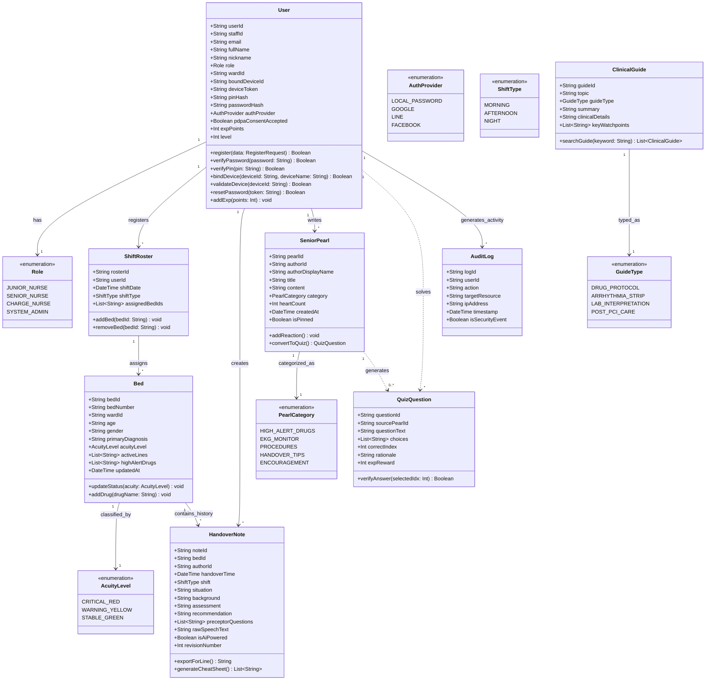

# แผนภาพคลาส (Class Diagram)
## โครงการ: The Note Nurse (เพื่อนคู่คิดและพี่เลี้ยงพยาบาลอัจฉริยะ)

เอกสารนี้แสดงโครงสร้างเชิงวัตถุ (Domain Class Model) ของระบบ The Note Nurse ประกอบด้วย Attributes, Methods และความสัมพันธ์ระหว่าง Entity ต่างๆ ที่สอดคล้องตามกฎหมาย PDPA (De-identified Health Model)

---

### 1. แผนภาพ Class Diagram (Mermaid Graph)

---

### 2. คำอธิบาย Entity สำคัญและการปฏิบัติตาม PDPA

| คลาส (Class) | คำอธิบายและความสำคัญ | หมายเหตุความปลอดภัย / PDPA |
| :--- | :--- | :--- |
| **User** | ข้อมูลพยาบาลผู้ใช้งานในระบบ สังกัดวอร์ด และระดับเลเวล | จัดเก็บรหัสผ่านแบบ Salted Hash, เก็บ PIN แยกต่างหาก |
| **ShiftRoster** | การจัดเวรปฏิบัติงาน (เช้า/บ่าย/ดึก) และเตียงที่รับผิดชอบ | ช่วยจำกัดสิทธิ์ให้พยาบาลเห็นเฉพาะเตียงที่ตนเองดูแล |
| **Bed** | ตัวแทนคนไข้และเตียงในวอร์ด (เช่น เตียง 2 CCU) | **ไม่มีการเก็บชื่อ นามสกุลจริง หรือ HN** ใช้เพียง Bed Number, อายุ, เพศ และข้อมูลโรค |
| **HandoverNote** | โน้ตส่งเวรโครงสร้าง SBAR พร้อมคำถาม Cheat Sheet | เก็บประวัติเป็น Revision ป้องกันการลบทำลายย้อนหลังตามข้อกำหนดเวชระเบียน |
| **SeniorPearl** | เกร็ดความรู้และทริคที่รุ่นพี่แบ่งปัน | สามารถแปลงเนื้อหาไปเป็นโจทย์ควิซได้แบบอัตโนมัติ |
| **QuizQuestion** | ธนาคารคำถามทบทวนความรู้ทางคลินิก | มีเฉลยและเหตุผลทางการพยาบาล (Rationale) พร้อมแต้ม EXP |
| **AuditLog** | บันทึกประวัติการเข้าใช้งานและความปลอดภัย | เก็บรักษาย้อนหลังไม่น้อยกว่า 90 วันตามมาตรฐาน PDPA |

