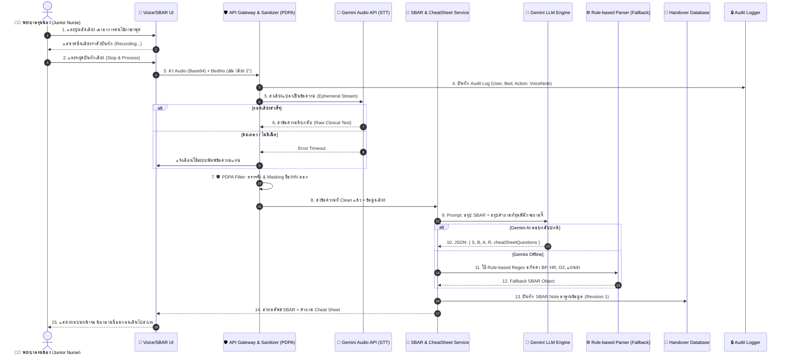
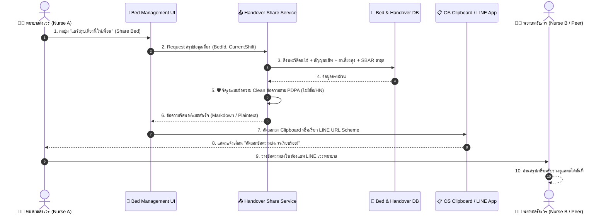
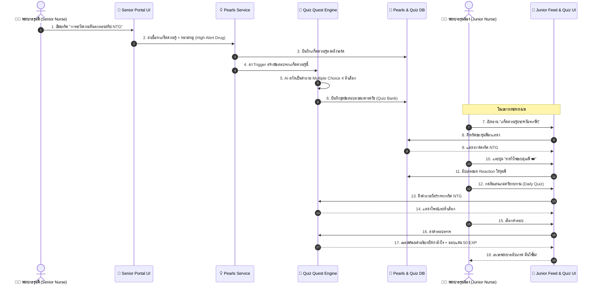

# แผนภาพลำดับขั้นตอนการทำงาน (Sequence Diagram)
## โครงการ: The Note Nurse (เพื่อนคู่คิดและพี่เลี้ยงพยาบาลอัจฉริยะ)

เอกสารนี้แสดงลำดับการส่งข้อมูลระหว่างวัตถุ (Sequence of Interactions) ใน 3 กระบวนการหลักของระบบ:
1. **Flow 1: การบันทึกเสียง ➡️ กรอง PDPA ➡️ สร้างรายงาน SBAR + Cheat Sheet ดักคำถาม**
2. **Flow 2: การแชร์สรุปข้อมูลเตียงคนไข้ให้เพื่อน (Handover Sharing via LINE / Clipboard)**
3. **Flow 3: การเผยแพร่เกร็ดความรู้จากรุ่นพี่ ➡️ แปลงเป็นโจทย์ควิซ ➡️ รุ่นน้องฝึกทำข้อสอบ**

---

### Flow 1: การบันทึกเสียง ➡️ กรอง PDPA ➡️ แปลงเป็น SBAR + Cheat Sheet ดักคำถาม

---

### Flow 2: การแชร์สรุปข้อมูลเตียงคนไข้ให้เพื่อน (Handover Sharing via LINE / Clipboard)

---

### Flow 3: การแชร์เกร็ดความรู้จากรุ่นพี่ ➡️ แปลงเป็นโจทย์ควิซ ➡️ รุ่นน้องฝึกทำข้อสอบ

