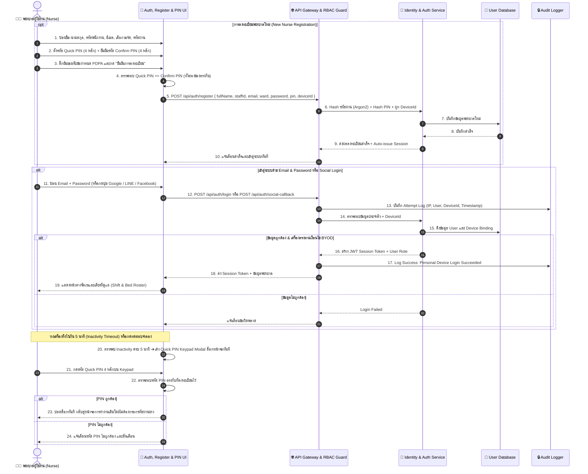
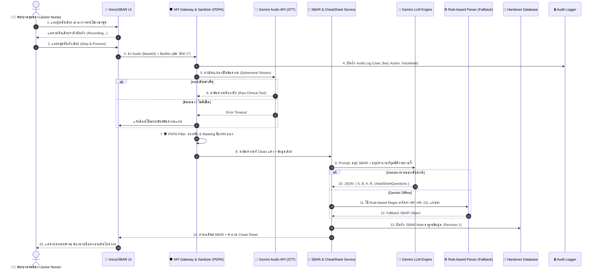
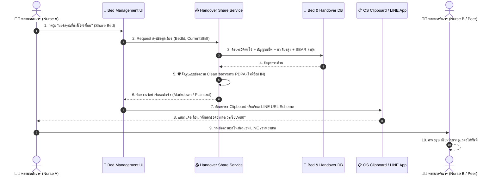
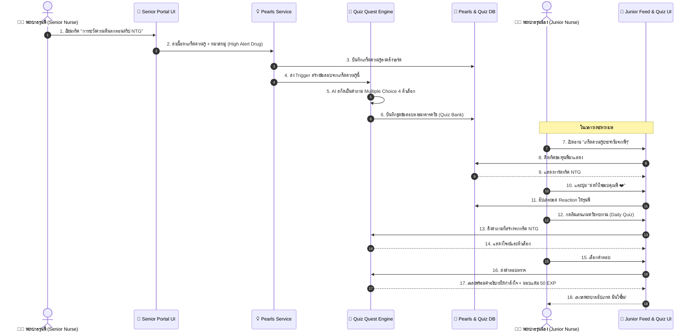

# แผนภาพลำดับขั้นตอนการทำงาน (Sequence Diagram)
## โครงการ: The Note Nurse (เพื่อนคู่คิดและพี่เลี้ยงพยาบาลอัจฉริยะ)

เอกสารนี้แสดงลำดับการส่งข้อมูลระหว่างวัตถุ (Sequence of Interactions) ใน 4 กระบวนการหลักของระบบ:
1. **Flow 0: การเข้าสู่ระบบด้วย Email & Password ➡️ ปลดล็อกด่วนด้วย Quick PIN (Authentication Flow)**
2. **Flow 1: การบันทึกเสียง ➡️ กรอง PDPA ➡️ สร้างรายงาน SBAR + Cheat Sheet ดักคำถาม**
3. **Flow 2: การแชร์สรุปข้อมูลเตียงคนไข้ให้เพื่อน (Handover Sharing via LINE / Clipboard)**
4. **Flow 3: การเผยแพร่เกร็ดความรู้จากรุ่นพี่ ➡️ แปลงเป็นโจทย์ควิซ ➡️ รุ่นน้องฝึกทำข้อสอบ**

---

### Flow 0: การลงทะเบียน, เข้าสู่ระบบ (Email/Social) ➡️ ปลดล็อกด่วนด้วย Quick PIN (Auth & Registration Flow)

---

### Flow 1: การบันทึกเสียง ➡️ กรอง PDPA ➡️ แปลงเป็น SBAR + Cheat Sheet ดักคำถาม

---

### Flow 2: การแชร์สรุปข้อมูลเตียงคนไข้ให้เพื่อน (Handover Sharing via LINE / Clipboard)

---

### Flow 3: การแชร์เกร็ดความรู้จากรุ่นพี่ ➡️ แปลงเป็นโจทย์ควิซ ➡️ รุ่นน้องฝึกทำข้อสอบ

