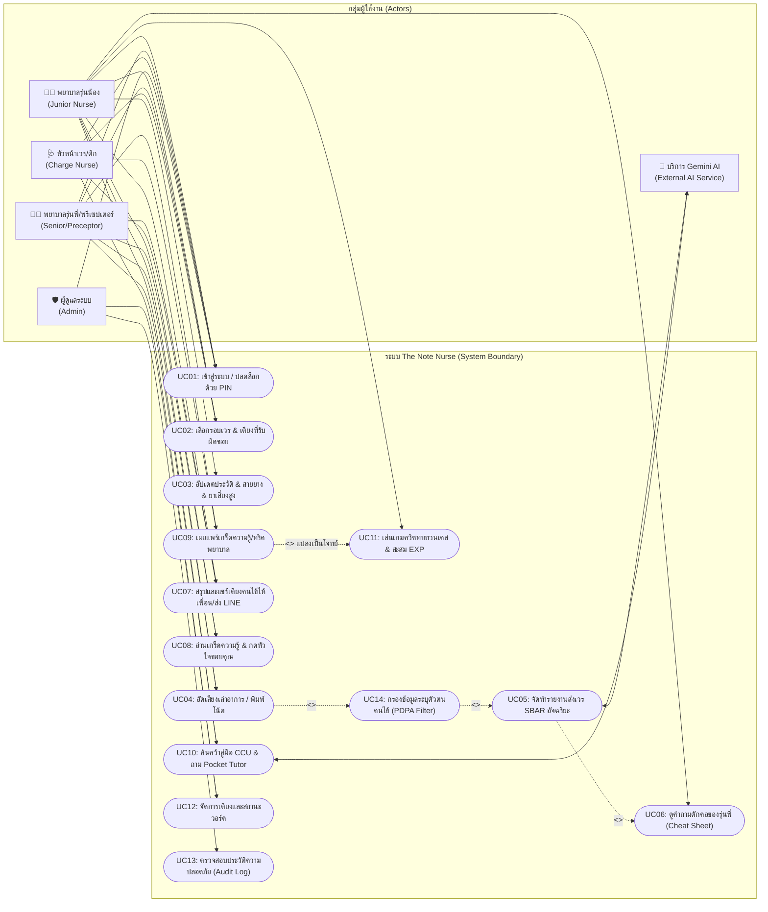

# แผนภาพยูสเคส (Use Case Diagram)
## โครงการ: The Note Nurse (เพื่อนคู่คิดและพี่เลี้ยงพยาบาลอัจฉริยะ)

เอกสารนี้แสดงขอบเขตปฏิสัมพันธ์ระหว่างผู้ใช้งานกลุ่มต่างๆ (Actors) กับฟังก์ชันการทำงานหลักของระบบ The Note Nurse ภายใต้การควบคุมสิทธิ์ (RBAC) และการคุ้มครองข้อมูลส่วนบุคคล (PDPA)

---

### 1. แผนภาพ Use Case Diagram (Mermaid Graph)

---

### 2. คำอธิบายสาระสำคัญของ Use Case

| Use Case ID | ชื่อฟังก์ชัน | ผู้ใช้งานหลัก | ผลลัพธ์ / ประโยชน์ |
| :--- | :--- | :--- | :--- |
| **UC01** | เข้าสู่ระบบ / ปลดล็อกด้วย PIN | ทุกคน | ยืนยันตัวตนรวดเร็วด้วย PIN 4-6 หลัก สลับหน้าจอระหว่างเวรได้อย่างปลอดภัย |
| **UC02** | เลือกรอบเวร & เตียงที่รับผิดชอบ | JN, SN, CN | คัดกรองเฉพาะคนไข้ในความรับผิดชอบ ไม่สับสนกับเตียงอื่นในวอร์ด |
| **UC03** | อัปเดตประวัติ & สายยาง & ยา | JN, SN, CN | บันทึกประวัติ อุปกรณ์ที่คาอยู่ (Lines) และยาเสี่ยงสูงประจำเตียง |
| **UC04** | อัดเสียงเล่าอาการ / พิมพ์โน้ต | JN, SN | พูดเล่าอาการภาษาธรรมชาติผ่านไมค์ได้อย่างอิสระ ไม่ต้องกังวลเรื่องแบบฟอร์ม |
| **UC05** | จัดทำรายงานส่งเวร SBAR | JN, SN, AI | AI แปลงข้อความเป็น SBAR ที่ถูกต้องตามมาตรฐานพยาบาลวิชาชีพ |
| **UC06** | ดูคำถามดักคอของรุ่นพี่ | JN | แสดงสิ่งที่รุ่นพี่มักจะถามจี้ ให้น้องเตรียมคำตอบก่อนเดินไปส่งเวรจริง |
| **UC07** | แชร์เตียงคนไข้ให้เพื่อน/ส่ง LINE | JN, SN, CN | จัดฟอร์แมตสรุปข้อมูลเตียงใน 1 คลิก ส่งต่อเพื่อนร่วมเวรหรือกลุ่ม LINE ปลอดภัยตาม PDPA |
| **UC08** | อ่านเกร็ดความรู้ & กดหัวใจ | JN, SN | รับความรู้ประจำวันและส่งคำขอบคุณสร้างกำลังใจให้รุ่นพี่ |
| **UC09** | เผยแพร่เกร็ดความรู้/ทริคพยาบาล | SN, CN | รุ่นพี่ถ่ายทอดประสบการณ์จริงเฉพาะวอร์ด CCU สู่รุ่นน้อง |
| **UC10** | ค้นคว้าคู่มือ CCU & ถาม Tutor | JN, SN, AI | ค้นหายา, EKG, ผลแล็บ และถาม AI พี่เลี้ยงได้ 24 ชม. ไม่โดนด่า |
| **UC11** | เล่นเกมควิซ & สะสม EXP | JN, SN | ฝึกตอบคำถามจำลองสถานการณ์ส่งเวร เพิ่มความมั่นใจและเลเวลพยาบาล |
| **UC12** | จัดการเตียงและสถานะวอร์ด | CN, AD | เพิ่ม/แก้ไข/ย้ายเตียง และปรับระดับความวิกฤตของทั้งวอร์ด |
| **UC13** | ตรวจสอบประวัติ (Audit Log) | AD | ตรวจสอบประวัติการเข้าใช้งานตามข้อกำหนด พ.ร.บ. คุ้มครองข้อมูลส่วนบุคคล |
| **UC14** | กรองข้อมูลระบุตัวตนคนไข้ | ระบบอัตโนมัติ | กรองชื่อ-นามสกุล, เลขประจำตัวประชาชน และ HN ออกก่อนส่งให้ AI ภายนอก |

